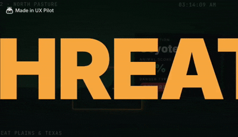
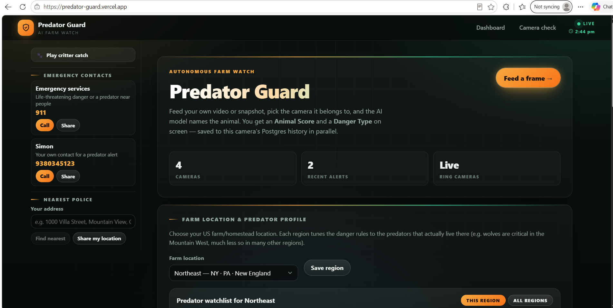
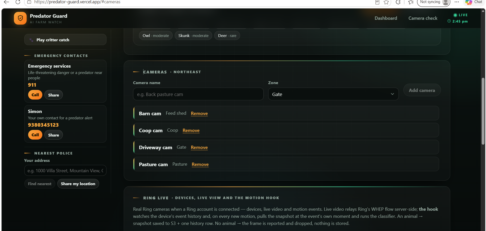
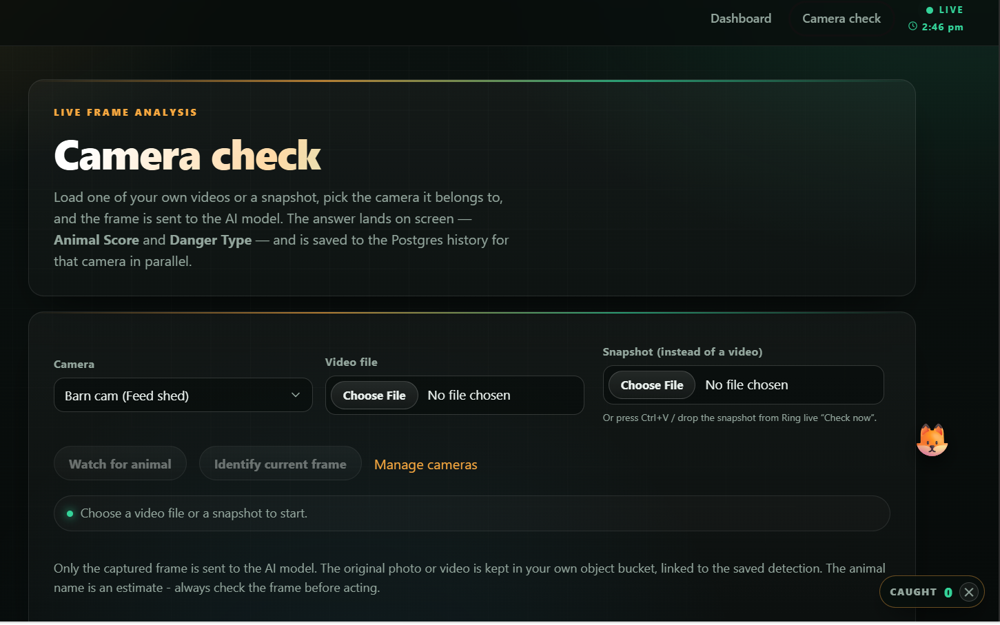

# Predator Guard

Predator Guard analyzes a video frame or snapshot, identifies the animal, and estimates its danger based on the farm region, camera zone, and time. Results are saved to the dashboard's detection history.

This demo uses media you provide; it does not connect to Ring devices or Ring device APIs. Animal identification is an estimate, not a substitute for human judgment.

What does touch Ring's infrastructure, live: the **Ring Docs** dashboard section queries the **Ring Appstore Knowledge MCP** server (`mcp.json` → `https://knowledge.appstore-mcp.ring.amazon.dev/mcp`) for real-time `search_docs` / `get_doc` answers. The browser only ever calls this app's own `/api/ring-docs` route; the gateway is reached server-side only.

And with `RING_ACCESS_TOKEN` (a generated OAuth token in root `.env.local`), the **Ring live** section talks to the **Ring Partner API** for real: device list, WHEP live video, event history and image snapshots. The auto hook watches a device's event history; on each new motion event it snapshots at the event's moment, classifies with the same model, and **saves the snapshot to S3 + one history row only when an animal is in the frame**.

### Threat alert in action




## Product walkthrough

Live demo: <https://predator-guard.vercel.app>

### Dashboard — home

The main dashboard. Feed a video frame or snapshot, pick the camera it belongs to, and the AI model names the animal with an **Animal Score** and a **Danger Type** on screen. Live camera, alert and camera counts sit up top, and the farm region picker tunes danger rules to the predators that actually live around your farm.



### Cameras — manage cameras and Ring live

Register cameras per zone (feed shed, coop, gate, pasture — barn, coop, driveway and pasture cams in the shot) and manage them from this panel. Below it, the **Ring live** section connects real Ring cameras: devices, WHEP live video and a motion hook that snapshots on every new motion event and runs the classifier — saving to S3 and history only when an animal is in the frame.



### Camera check — live frame analysis

Run a check on demand: load one of your own videos or a snapshot (or paste/drop one from the Ring live view), pick the camera, and the frame is sent to the AI model. The answer lands on screen — Animal Score and Danger Type — and is saved to that camera's Postgres history in parallel.



## Run locally

Requirements: Node.js 20 or later.

```powershell
npm install
Copy-Item .env.example .env.local
npm run dev
```

Open <http://localhost:3000>. The app uses a local PGlite database by default. `.env.local` is loaded from the repository root and must not be committed.

The **Ring docs** section of the dashboard is backed by the Ring MCP config at the repository root (`mcp.json`). Point `RING_MCP_URL` at a different gateway in `.env.local` to override it.

Set `RING_ACCESS_TOKEN` (a fresh OAuth token from the Ring Dev Portal) in the same root `.env.local` to enable the **Ring live** section - real cameras, live video and the motion hook. **Restart `npm run dev` after any `.env.local` change** (tokens included): the runner publishes the env files to the Next workers at boot.

To enable animal identification, add your OpenRouter key to the repository-root `.env.local`:

```env
OPENROUTER_API_KEY=your-key
```

Set `OPENROUTER_VISION_MODEL` to its model ID (choose that accepts images):

```env
OPENROUTER_VISION_MODEL=openai/gpt-4o-mini
```

Keep both values in the same root `.env.local`.

## DataBase services

- **PostgreSQL:** Set `DATABASE_URL` in `.env.local`. For local development.
- **Object storage:** Set `AWS_ACCESS_KEY_ID` and `AWS_SECRET_ACCESS_KEY` to save uploaded media and analyzed frames. For S3-compatible storage, also set `AWS_ENDPOINT_URL_S3`; `AWS_REGION` and `AWS_S3_BUCKET` are optional.

See `.env.example` for the available environment variables. Never add real credentials to it or to Git.

## Project layout

- `apps/web` — Next.js app, dashboard, camera check, and API routes
- `packages/db` — database schema and migrations
- `packages/rules` — regional predator and danger rules
- `packages/vision` — vision classifier types and OpenRouter adapter
- `packages/ring` — shared Ring-domain types; no Ring API integration

## Useful links

- `/video` — analyze a video or snapshot
- `/openapi.json` — API specification
- `/llms.txt` — site and API guide for AI tools
- [`docs/E2E_SCENARIOS.md`](docs/E2E_SCENARIOS.md) — end-to-end test scenarios
- [`docs/FRICTION_LOG.md`](docs/FRICTION_LOG.md) — development notes
- [`CONTRIBUTING.md`](CONTRIBUTING.md) — contribution workflow
